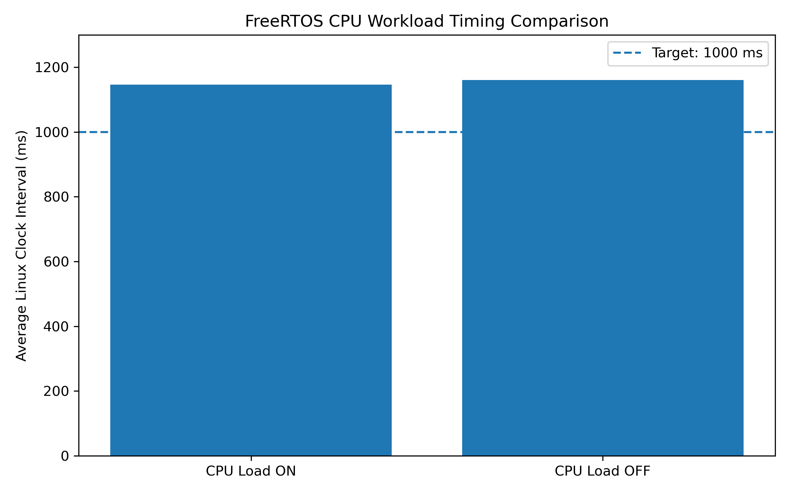
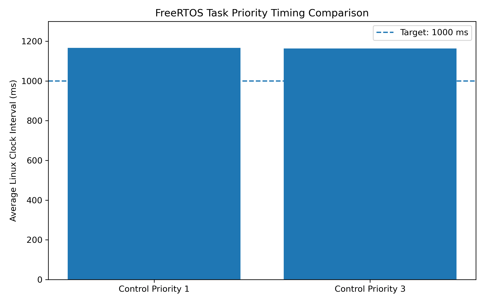

# FreeRTOS-Based Real-Time Industrial Motor Monitoring

A software-only industrial motor monitoring and protection simulation developed using C and FreeRTOS on Ubuntu Linux.

The project demonstrates FreeRTOS multitasking, inter-task communication, periodic scheduling, motor overheating protection, automated testing, and scheduling performance analysis.

**Platform:** FreeRTOS GCC POSIX port (Linux-hosted simulation)

## 1. Project Overview

The objective is to simulate an industrial motor monitoring system using FreeRTOS.

A simulated temperature sensor periodically generates readings. The readings are transferred to a motor control task through a FreeRTOS queue.

The control task monitors temperature and performs simulated motor shutdown when overheating is detected.

The project does not require physical hardware.

## 2. Technologies Used

- C Programming
- FreeRTOS
- Ubuntu Linux
- GCC
- CMake
- Python 3
- Matplotlib
- Git and GitHub

## 3. System Architecture

The application implements three FreeRTOS tasks:

| Task | Priority | Function |
|---|---|---|
| Sensor Task | 2 | Generates temperature readings |
| Control Task | 1 | Monitors temperature and motor state |
| CPU Load Task | 1 | Generates computational workload |

The CPU Load Task is disabled in the current application configuration. It was used during scheduling experiments.

### Communication

The Sensor Task communicates with the Control Task through a FreeRTOS queue.

The Sensor Task uses `vTaskDelayUntil()` with a nominal period of 1000 ms.

## 4. Motor Protection Logic

The simulated motor follows these rules:

| Temperature Condition | Motor Behavior |
|---|---|
| Normal operation below 70°C | Motor RUNNING |
| Temperature reaches 70°C or above | Motor SHUTDOWN |
| Temperature remains above 50°C after shutdown | Motor remains OFF |
| Temperature falls to 50°C or below after shutdown | Automatic simulated reset and restart |

The reset request is generated automatically by the application.

These thresholds are demonstration values and do not represent a certified industrial protection system.

## 5. Automated Testing

Python integration tests verify the motor's observable behavior.

| Test Case | Result |
|---|---|
| Normal motor operation at 65°C | PASS |
| Motor shutdown at 70°C | PASS |
| Motor remains OFF at 75°C | PASS |
| Motor restart at 30°C | PASS |
| Correct motor state sequence | PASS |

**Automated test results: 5/5 PASS**

The tests inspect simulation output and verify expected temperature-state combinations and event order.

## 6. Scheduling Performance Analysis

### CPU Workload Comparison

| Configuration | Average Linux Clock Interval |
|---|---|
| CPU Load ON | 1146.49 ms |
| CPU Load OFF | 1160.71 ms |

### Task Priority Comparison

| Control Task Priority | Average Linux Clock Interval |
|---|---|
| Priority 1 | 1166.34 ms |
| Priority 3 | 1163.89 ms |

The measurements are preliminary and based on small sample sets.

They do not establish that one configuration provides better real-time performance.

## 7. Timing Interval Monitoring

The intended Sensor Task period is 1000 ms.

The application measures timing using:

- FreeRTOS tick counter
- Linux monotonic clock

FreeRTOS reported 1000 ms intervals at simulated tick resolution.

Linux wall-clock measurements frequently exceeded 1000 ms.

A timing interval check reports when the measured Linux clock interval exceeds 1000 ms.

This is an interval-threshold check, not a complete task execution-deadline analysis.

## 8. Performance Graphs

### CPU Workload Comparison



### Task Priority Comparison



## 9. Technical Documentation

- [Technical Report](TECHNICAL_REPORT.md)
- [Timing Results](TIMING_RESULTS.md)
- [Task Priority Results](PRIORITY_TEST_RESULTS.md)
- [Motor Safety Test Results](SAFETY_TEST_RESULTS.md)
- [Timing Interval Analysis](DEADLINE_ANALYSIS.md)

## 10. Build and Run

### Requirements

- Ubuntu Linux
- GCC
- CMake
- Git
- Python 3
- Matplotlib for generating graphs

Install the dependencies:

```bash
sudo apt update
sudo apt install -y build-essential cmake git python3 python3-matplotlib
```

### Clone the Project

```bash
mkdir FreeRTOS_Master_Project
cd FreeRTOS_Master_Project

git clone https://github.com/Ajithsing-Desing/FreeRTOS-Real-Time-Industrial-Motor-Monitoring.git RTOS_Application

git clone https://github.com/FreeRTOS/FreeRTOS-Kernel.git

cd FreeRTOS-Kernel
git checkout ca75944d4e9ca59cfa3a9faa6cb8b49e0772ca520

cd ../RTOS_Application
```

The FreeRTOS kernel must be located in the parent directory alongside `RTOS_Application`.

### Compile

```bash
cmake -S . -B build
cmake --build build -j2
```

### Run

```bash
./build/rtos_simulation
```

### Automated Testing

```bash
python3 test_motor.py
```

### Generate Performance Graphs

```bash
python3 plot_performance.py
```

## 11. Project Limitations

- The application runs using the FreeRTOS GCC POSIX port on Linux.
- No physical STM32 microcontroller is used.
- Temperature readings and motor operation are simulated.
- Motor reset is automatically simulated.
- Linux-hosted timing measurements do not demonstrate hardware real-time guarantees.
- Performance comparisons require additional repeated experiments.
- This is not a certified industrial motor safety system.

## 12. Conclusion

This project demonstrates practical implementation of FreeRTOS task management, queue-based communication, periodic scheduling, simulated motor protection, automated integration testing, and timing analysis.

It provides experience with embedded software concepts and real-time operating system programming in a Linux-hosted simulation.
