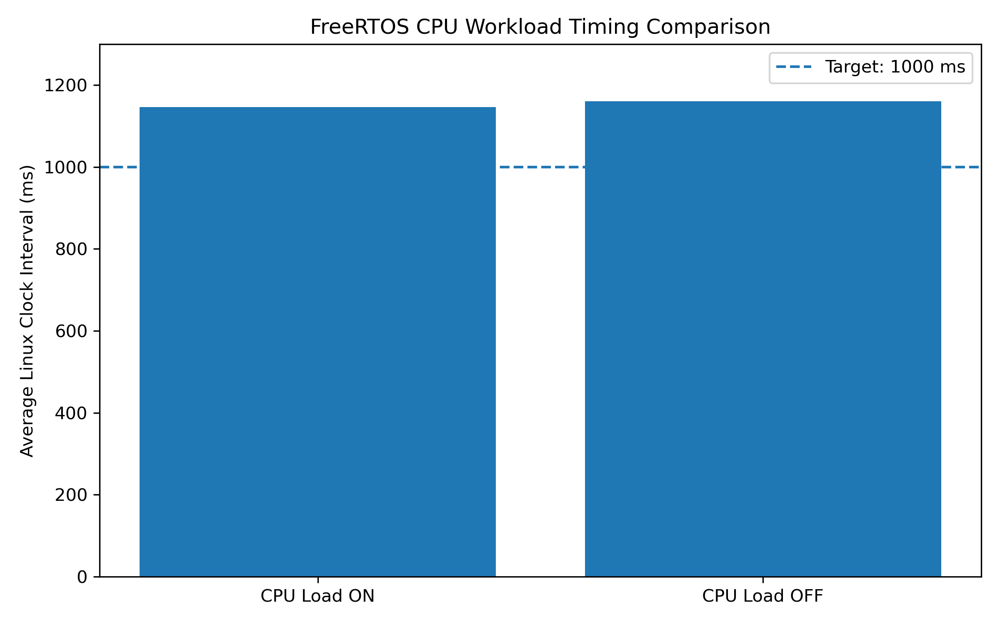
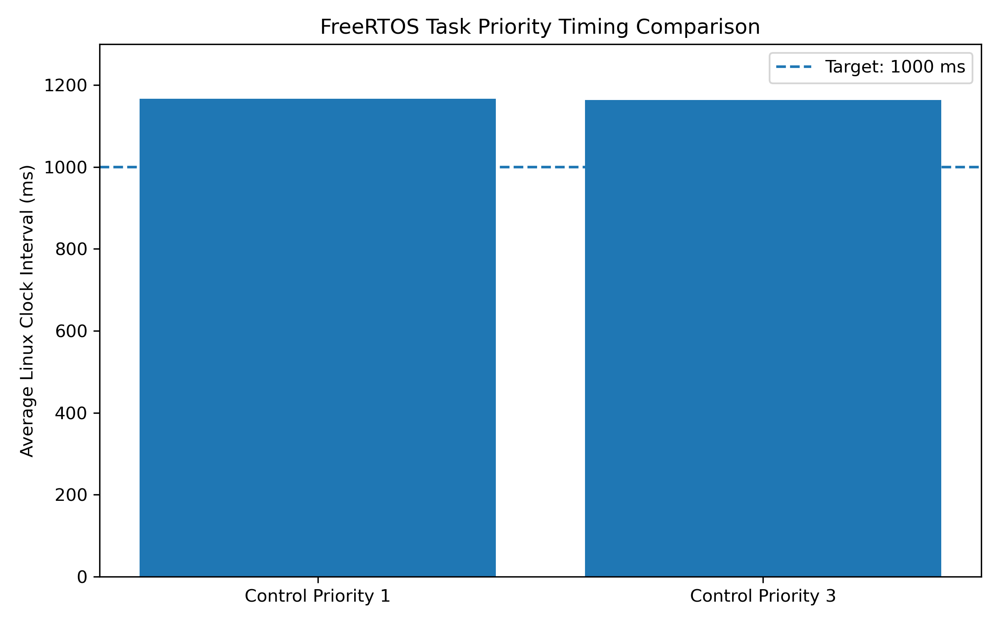

# FreeRTOS-Based Industrial Motor Monitoring and Safety Control

## 1. Project Overview

This project implements a simulated industrial motor
monitoring system using FreeRTOS and C.

The application runs using the FreeRTOS GCC POSIX port
on Ubuntu Linux.

The system monitors simulated temperature readings
and controls a simulated motor based on overheating
conditions.

## 2. System Architecture

The application uses three FreeRTOS tasks:

- Sensor Task: Generates simulated temperature readings.
- Control Task: Processes temperature readings and
  manages the simulated motor state.
- CPU Load Task: Generates computational workload
  for scheduling experiments.

The Sensor Task communicates with the Control Task
using a FreeRTOS queue.

The CPU Load Task is currently disabled in the
final application configuration.

## 3. Motor Control Logic

- Below 70 C: Motor operates normally.
- At 70 C or above: Motor shuts down.
- After shutdown: Motor remains off until the
  simulated reset condition is satisfied.
- At 50 C or below: An automatic simulated reset
  allows the motor to restart.

## 4. Automated Testing

Python integration tests verify:

- Normal motor operation at 65 C.
- Motor shutdown at 70 C.
- Motor remaining off at 75 C.
- Motor restart at 30 C.
- Correct order of motor state transitions.

Result: 5/5 checks passed.

## 5. Scheduling Experiments

### CPU Workload Comparison

| Configuration | Average Linux Interval |
|---|---|
| CPU Load ON | 1146.49 ms |
| CPU Load OFF | 1160.71 ms |

### Task Priority Comparison

| Control Task Priority | Average Linux Interval |
|---|---|
| 1 | 1166.34 ms |
| 3 | 1163.89 ms |

The results are preliminary and do not establish
a performance advantage for either configuration.

## 6. Timing Interval Monitoring

The intended Sensor Task period is 1000 ms.

FreeRTOS reported intervals of 1000 ms at its
simulated tick resolution.

Linux wall-clock measurements frequently exceeded
1000 ms.

The application reports an interval violation
when the Linux clock interval exceeds 1000 ms.

This is an interval check rather than a complete
task execution-deadline measurement.

## 7. Project Limitations

- No physical STM32 microcontroller was used.
- No physical motor or temperature sensor was used.
- Motor reset is automatically simulated.
- Linux-hosted timing results do not demonstrate
  hardware real-time deadline guarantees.
- More repeated experiments are needed for
  statistically meaningful performance comparisons.

## 8. Conclusion

The project demonstrates FreeRTOS task management,
queue-based communication, simulated motor protection,
task priority experiments, timing measurements,
and Python-based integration testing.

It provides practical experience with embedded
software concepts in a Linux-hosted simulation.

## 9. Performance Graphs

### CPU Workload Comparison

### Task Priority Comparison

These graphs present preliminary Linux-hosted
FreeRTOS timing measurements.

The results should not be interpreted as
guaranteed real-time performance on hardware.
